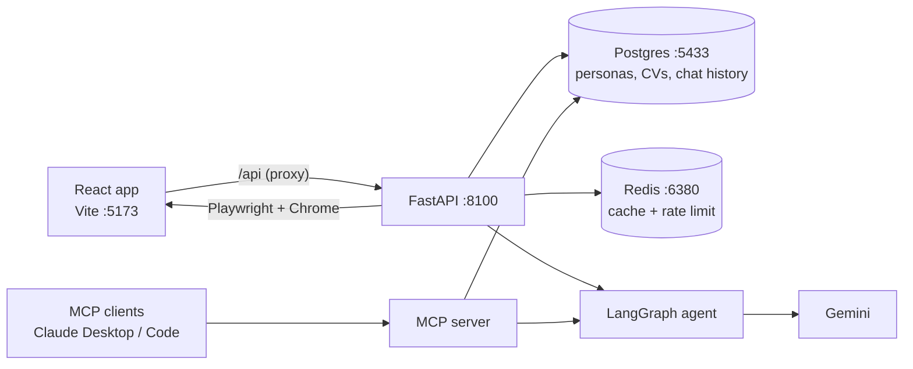
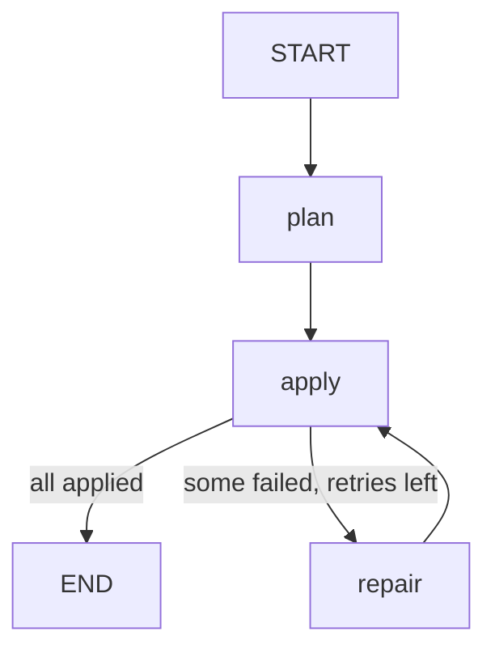

# ResuMaker

Build CVs from layouts: pick a layout, fill in your details once, rearrange sections with a drag-and-drop drawer, get AI help, download a PDF.

Built for a household, so there is no login: you pick a **persona** (yourself, a family member), see their CVs, or create another CV or another persona.



| Part | What it does |
|---|---|
| `src/` | React + TypeScript UI: layouts, editor, drawer, preview. CVs are loaded/autosaved through the API. |
| `backend/app/api` | FastAPI REST API (CVs, Improve, chat, PDF). |
| `backend/app/domain` | Typed CV model, layout/template catalog, and the **operations engine**, the one place edits are validated and applied. |
| `backend/app/agent` | The LangGraph editing agent (below). |
| `backend/app/mcp_server.py` | MCP server exposing the same capabilities to MCP clients. |
| Postgres | **Personas** (people, with their personal details) and their **CVs** as validated JSONB documents with optimistic versioning, plus per-CV chat history. The schema is managed by Alembic migrations. |
| Redis | Caches Improve results (24h) and rendered PDFs (keyed by content hash), and rate-limits AI calls per IP. Redis down = cache miss, never an error. |

## Run it

Everything runs in Docker with hot reload. You only need Docker and a Gemini key.

```bash
cp .env.example .env        # add GEMINI_API_KEY
make stack                  # full build + start everything, wait until healthy
```

`make` lists every target (`make up`, `make logs`, `make test`, `make graph`, `make db-backup`, …). Plain `docker compose up --build` works too.

Open **http://localhost:5173**. Edits to `src/` hot-reload (Vite HMR) and edits to `backend/app/` restart the API (uvicorn `--reload`).

| Service | What | Host port |
|---|---|---|
| `web` | Vite dev server (React app), proxies `/api` to `api` | 5173 (`WEB_PORT`) |
| `api` | FastAPI + LangGraph agent, with Chromium for PDFs | 8100 (`API_PORT`) |
| `db` | Postgres 16 (data in the `resumaker-pgdata` volume) | 5433 |
| `redis` | Redis 7 (cache, no persistence) | 6380 |
| `mcp` | MCP server (stdio), started on demand, see below | n/a |

All ports bind to `127.0.0.1`. If something already uses 5173 (for example a local `npm run dev`), `make` names the process and you can run `make stack WEB_PORT=5174`.

```bash
npm run logs                              # follow api + web logs
docker compose exec api pytest            # backend tests (own test DB + Redis db 15)
docker compose down                       # stop (data is kept); add -v to also delete the database
docker compose build --no-cache api       # after changing backend dependencies (pyproject.toml / uv.lock)
```

Frontend dependency changes are picked up automatically: the `web` container runs `npm install` on every start.

**Without Docker for the app** (faster for some workflows): `npm run infra` starts just Postgres and Redis, then `npm run api` and `npm run dev` run the API and frontend on the host (needs Node 22+, [uv](https://docs.astral.sh/uv/) and Chrome). The same `.env` and ports work.

## Personas and CVs

A **persona** is a person: name, email, phone, address, birth date and place, nationality. A persona owns any number of **CVs**. A CV stores only its own content and its **headline** (the role it targets, e.g. "AI Strategy Lead" vs "Senior Software Engineer"). The personal details are read live from the persona, so editing them in any CV, or on the persona page, updates all of that person's CVs. Deleting a persona deletes its CVs (the UI asks first).

Schema changes go through Alembic (`backend/migrations/`); the API applies them on startup. `make migration m="..."` creates one, and `make db-backup` dumps the database first (into the git-ignored `backups/`). Migration `0002` introduced personas: it backfilled a persona for every existing CV, merging CVs of the same person by name and email.

## The agent

`plan` asks Gemini for a structured list of edit operations. `apply` runs them through the operations engine (deterministic, validated). If some fail, `repair` shows the model what failed and why and asks for corrected operations, up to twice. The model only *proposes*; validated code decides what changes.



## MCP server

Lets Claude Desktop / Claude Code list, read, edit, improve and export your CVs. It uses the same database and engine, so edits appear in the editor. (Deleting CVs is deliberately not exposed. `export_pdf` needs the frontend running; from the Docker server, files land in `backend/.data/pdfs/`.)

```bash
# Claude Code (runs the server in Docker on demand; the stack from `docker compose up` must have db + redis healthy)
claude mcp add resumaker -- docker compose -f "$(pwd)/docker-compose.yml" run --rm -T mcp

# Or on the host, no Docker for the server:
claude mcp add resumaker -- uv --directory "$(pwd)/backend" run python -m app.mcp_server
#   HTTP instead of stdio:  npm run mcp -- --http   →  http://127.0.0.1:8101/mcp
```

Claude Desktop (`claude_desktop_config.json`):

```json
{ "mcpServers": { "resumaker": { "command": "docker", "args": ["compose", "-f", "/ABSOLUTE/PATH/TO/ResuMaker/docker-compose.yml", "run", "--rm", "-T", "mcp"] } } }
```

Tools: `list_personas`, `create_persona`, `list_resumes`, `get_resume`, `create_resume`, `apply_operations`, `improve_text`, `ask_assistant`, `export_pdf`. Resource: `resume://{id}`. Prompt: `review_cv`.

## Notes and limits

- **No login, on purpose.** Anyone who can reach the app can open any persona's CVs. That is fine for a household on a trusted network; add authentication before exposing it more widely.
- **The catalog exists twice** (TypeScript for the UI, Python for the agent/MCP). `backend/tests/test_catalog_parity.py` fails if they drift.
- **PDFs** are rendered by headless Chrome loading `FRONTEND_URL/preview/<id>`, so the frontend must be reachable by the API (in Docker: `http://web:5173`). Chrome runs with `--no-sandbox` inside the container; it only ever loads our own page.
- **This is a development setup** (dev servers, bind mounts, default DB password). A production setup would build the frontend to static files behind nginx and drop the bind mounts.
- **Concurrent edits:** saves carry the version they were based on; a stale save is rejected (409) and the editor reloads the newer version.
