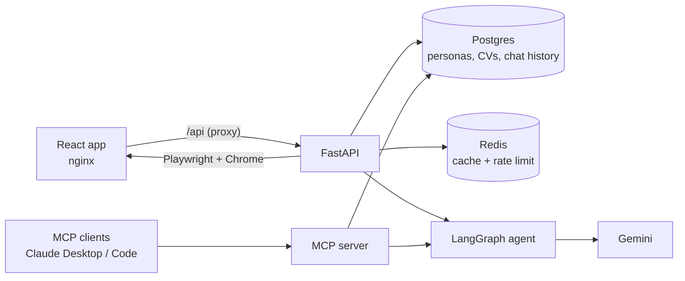
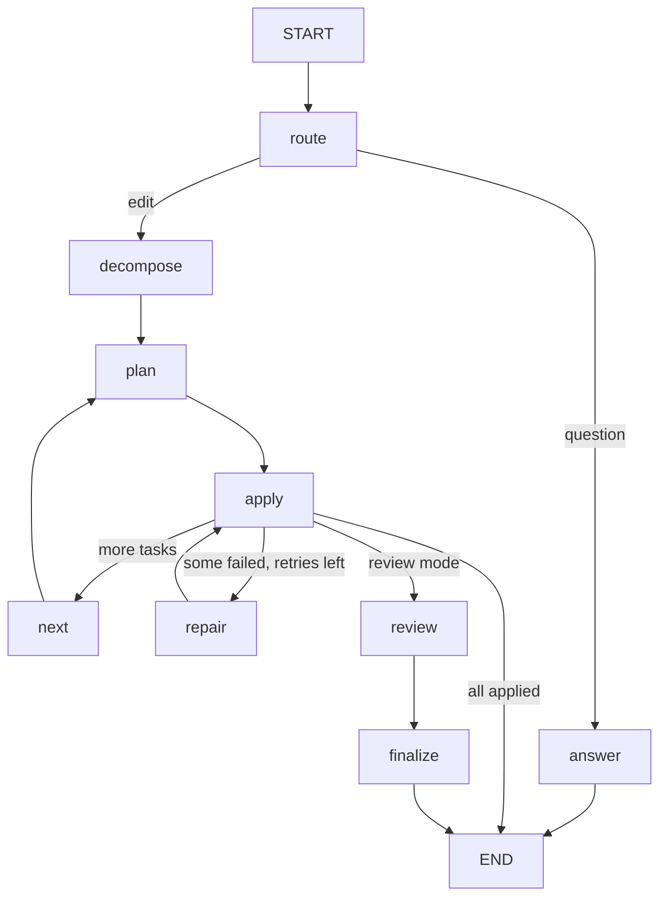

# ResuMaker

Build CVs from layouts: pick a layout, fill in your details once, rearrange sections with a drag-and-drop drawer, get AI help, download a PDF.

Built for a household, so there is no login: you pick a **persona** (yourself, a family member), see their CVs, or create another CV or another persona.



| Part | What it does |
|---|---|
| `src/` | React + TypeScript UI: layouts, editor, drawer, preview. CVs are loaded/autosaved through the API. |
| `backend/app/api` | FastAPI REST API (CVs, Improve, chat, PDF). |
| `backend/app/domain` | Typed CV model, layout/template catalog, and the **operations engine**, the one place edits are validated and applied. |
| `backend/app/agent` | The LangGraph editing agent (below). |
| `backend/app/mcp_server.py` | MCP server exposing the same capabilities to MCP clients. |
| Postgres | **Personas** (people, with their personal details) and their **CVs** as validated JSONB documents with optimistic versioning, plus per-CV chat history. The schema is managed by Alembic migrations. |
| Redis | Caches Improve results (24h) and rendered PDFs (keyed by content hash), and rate-limits AI calls per IP. Redis down = cache miss, never an error. |

## Run it

You need Docker and a Gemini key. There are **two completely separate stacks**, so work in progress can never disturb the app you actually use:

| | **Frozen** (`make stable-*`) | **Scratch** (`make stack`, …) |
|---|---|---|
| Purpose | The app you use, with your real data | A throwaway copy for testing changes |
| Built from | A git tag (`stable-1`), never the working tree | The working tree |
| Code in containers | Baked into the image: no bind mounts, no hot reload | Baked in too (`HOT=1` adds bind mounts and hot reload) |
| Web (nginx) | **5174** | **5180** |
| API / Postgres / Redis | 8100 / 5433 / 6380 | 8180 / 5434 / 6381 |
| Data | volume `resumaker_resumaker-pgdata` | volume `resumaker-scratch_scratch-pgdata` (empty, disposable) |

```bash
cp .env.example .env                 # add GEMINI_API_KEY

# Scratch: try the current code
make stack                           # build from the working tree, start, wait until healthy → http://localhost:5180
make stack HOT=1                     # same, with hot reload (Vite HMR + uvicorn --reload)
make test                            # backend tests against the scratch database
make scratch-reset                   # wipe the scratch stack completely (asks first)

# Frozen: the stable app
make stable-build                    # build images from git tag stable-1 (STABLE_TAG=… for another tag)
make stable-up                       # start / update → http://localhost:5174
make stable-expose                   # reachable from your local network (see below); make stable-hide undoes it
make stable-backup                   # dump the real database to backups/
```

`make` lists every target (logs, MCP, graph, personas, PDFs, migrations…). If something already uses a port, `make` names the process and you can override it, e.g. `make stack WEB_PORT=5181`.

**To freeze a new build:** commit, `git tag -a stable-2 -m "…"`, `make stable-build STABLE_TAG=stable-2`, then `make stable-up STABLE_TAG=stable-2`. The database is migrated on startup, so take a `make stable-backup` first.

**Local network.** `make stable-expose` publishes only the web port on all interfaces (`http://<your-ip>:5174`, or `http://<hostname>.local:5174`); the API, Postgres and Redis stay on localhost. There is no login, so anyone on that network can read and edit every CV. Only do this on a network you trust (not guest Wi-Fi).

Frontend dependency changes need a rebuild (`make build-web`) unless you use `HOT=1`, where the `web` container runs `npm install` on every start.

**Without Docker for the app:** `make infra` starts just the scratch Postgres and Redis, then `make local-api` and `make local-web` run the API and frontend on the host (needs Node 22+, [uv](https://docs.astral.sh/uv/) and Chrome). Host-side commands default to the **scratch** database, never the frozen one.

## Text formatting

Every text box (profile, descriptions, free-text sections) is **Markdown** (CommonMark + GitHub flavour): headings, **bold**, *italic*, ~~strikethrough~~, `code`, links, bulleted / numbered / task lists (nestable), quotes, tables and rules. The editor has a toolbar, shortcuts (⌘/Ctrl + B, I, K, ⇧X), list continuation on Enter, a Write / Preview toggle and a built-in cheat sheet. Single-line fields (bullets, highlight lines) take inline Markdown only. A single line break is kept as typed.

Rendering is safe by design: raw HTML is never rendered and images are not shown (a CV must not load remote content). Long lists and tables are split into page-breakable blocks, so they flow across PDF pages like any other content. In a bullet list on an entry, a line starting with `# ` is this app's own *subheading* marker (not a Markdown heading). `make test-web` runs the unit tests for the Markdown helpers.

## Personas and CVs

A **persona** is a person: name, email, phone, address, birth date and place, nationality. A persona owns any number of **CVs**. A CV stores only its own content and its **headline** (the role it targets, e.g. "AI Strategy Lead" vs "Senior Software Engineer"). The personal details are read live from the persona, so editing them in any CV, or on the persona page, updates all of that person's CVs. Deleting a persona deletes its CVs (the UI asks first).

Schema changes go through Alembic (`backend/migrations/`); the API applies them on startup. `make migration m="..."` creates one, and `make db-backup` dumps the database first (into the git-ignored `backups/`). Migration `0002` introduced personas: it backfilled a persona for every existing CV, merging CVs of the same person by name and email.

## The agent

`route` (a cheap model, `gemini-flash-lite-latest`) decides whether a message is a question or an edit request; if it fails, the message is treated as an edit. Questions go to `answer`, which replies in text and changes nothing. Edits go to `decompose` (the cheap model splits a big request, such as a whole-CV rewrite, tailoring or translation, into focused tasks: one per section, or per job; small requests stay one task, and any problem falls back to one task), then to `plan`, where Gemini returns a structured list of operations. `apply` runs them through the operations engine (deterministic, validated). If some fail, `repair` shows the model what failed and why and asks for corrected operations, up to twice. The model only *proposes*; validated code decides what changes.



**Review mode.** Tick "Review changes before applying" in the chat (or send `mode: "propose"`). The graph pauses at `review` and nothing is saved. The paused run is stored in Postgres by LangGraph's checkpointer (its own `checkpoint*` tables; Alembic ignores them), so it survives an API restart; unanswered proposals are pruned after 7 days. You then accept all, none, or some changes; `finalize` re-applies only the accepted ones. A proposal can be decided once (`410` afterwards), and if the CV changed meanwhile the decision fails with `409`.

`make eval-router` runs a golden set of 20 messages (questions vs. edits) against the real fast model (a few cents; excluded from `make test`). It currently scores 20/20.

`make eval-agent` runs 20 end-to-end editing tasks (single edits, multi-part requests, whole-CV rewrites, and the same on a 10-job CV) through the real graph and checks the resulting CV deterministically (no LLM judge). It reports pass rate, repairs and latency and writes `backend/.data/eval-report.json`; `EVAL_DECOMPOSE=0` runs the one-shot baseline. One run each: one-shot 19/20 (long CV: 2/3, it left every job of a tailoring request untouched), with decomposition 20/20 (long CV: 3/3). The price is latency, since tasks run one after another: about 11 s per task on average against 5.5 s. Phase 3 runs them in parallel. Single runs are noisy, so treat the gap as a trend, not a measurement.

**History and undo.** Every AI, MCP and restore change snapshots the CV first (last 100 kept), and autosaves checkpoint every 15 minutes. Undo restores the snapshot, so it works after a reload. `dryRun` on `/ops` previews changes without saving.

| Endpoint | |
|---|---|
| `POST /api/resumes/{id}/chat` | One turn, plain JSON. |
| `POST /api/resumes/{id}/chat/stream` | Same, as Server-Sent Events: `status`, `step`, then `done`, `proposal` or `error`. Body `{message, mode: "apply"\|"propose"}`. |
| `POST /api/resumes/{id}/chat/{runId}/decide` | `{accept: "all"\|"none"\|[indices]}` for a proposal. |
| `GET /api/resumes/{id}/versions`, `.../versions/{vid}`, `.../diff`, `POST .../restore` | History, diff and restore. |
| `POST /api/resumes/{id}/ops` | Apply operations; `dryRun: true` previews. |

## MCP server

Lets Claude Desktop / Claude Code list, read, edit, improve and export your CVs. It uses the same database and engine, so edits appear in the editor. (Deleting CVs is deliberately not exposed. `export_pdf` needs the frontend running; from the Docker server, files land in `backend/.data/pdfs/`.)

```bash
# Claude Code, against your REAL data (the frozen stack must be running: make stable-up)
claude mcp add resumaker -- docker compose -f "$(pwd)/docker-compose.stable.yml" run --rm -T mcp

# Against the scratch stack instead (empty database, for experiments): make mcp  /  make mcp-local
#   HTTP instead of stdio (scratch database):  make mcp-http   →  http://127.0.0.1:8101/mcp
```

Claude Desktop (`claude_desktop_config.json`):

```json
{ "mcpServers": { "resumaker": { "command": "docker", "args": ["compose", "-f", "/ABSOLUTE/PATH/TO/ResuMaker/docker-compose.stable.yml", "run", "--rm", "-T", "mcp"] } } }
```

Tools: `list_personas`, `create_persona`, `list_resumes`, `get_resume`, `create_resume`, `apply_operations` (with `dry_run`), `list_versions`, `diff_version`, `restore_version`, `improve_text`, `ask_assistant`, `propose_changes` + `decide_proposal` (review before applying), `export_pdf`. Resource: `resume://{id}`. Prompt: `review_cv`.

## Notes and limits

- **No login, on purpose.** Anyone who can reach the app can open any persona's CVs. That is fine for a household on a trusted network; add authentication before exposing it more widely.
- **The catalog exists twice** (TypeScript for the UI, Python for the agent/MCP). `backend/tests/test_catalog_parity.py` fails if they drift.
- **PDFs** are rendered by headless Chrome loading `FRONTEND_URL/preview/<id>`, so the frontend must be reachable by the API (in Docker: `http://web`, i.e. nginx, or `http://web:5173` with `HOT=1`). Chrome runs with `--no-sandbox` inside the container; it only ever loads our own page.
- **This is a development setup** (dev servers, bind mounts, default DB password). A production setup would build the frontend to static files behind nginx and drop the bind mounts.
- **Concurrent edits:** saves carry the version they were based on; a stale save is rejected (409) and the editor reloads the newer version.
